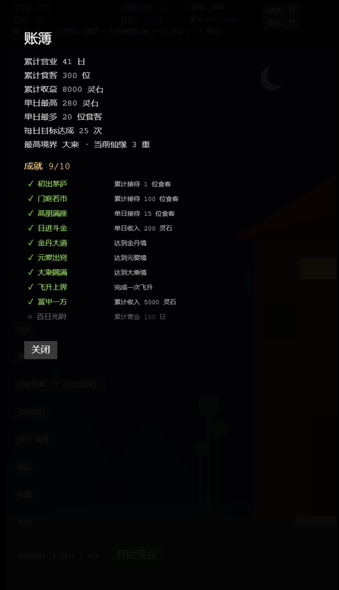

# 灵膳楼

修仙 × 酒楼经营。白日开门迎客赚灵石，夜里修行破境界；修到大乘可渡劫飞升，带着仙缘重开一局。

## 运行

```bash
npm install
npm run dev     # 本地开发
npm test        # 纯逻辑单元测试
npm run build   # 生产构建
```

画面按 720×1280 设计，Phaser FIT 缩放到手机竖屏或桌面窗口。

## 一局怎么玩

1. **打烊阶段**：采购灵材、雇伙计、营造（雅座 / 灶台 / 门面）、选今日菜单，然后点「开始营业」。
2. **营业中**：食客在门外排队，点「招待入座」；食客入座后会显示想吃的菜，点出菜行的对应菜品（端对口味售价 +50%）。也可以点「动手烹饪」按菜单顺序轮转。镜头可左右拖动查看队尾。
3. **结账与打烊**：用膳结束自动结账，获得灵石与修为。每天有一个可选目标，达成后结算额外灵石与修为。
4. **修行**：亲自下厨得双倍修为。修为推动炼气 → 筑基 → 金丹 → 元婴 → 化神 → 炼虚 → 合体 → 大乘，各境界给经营加成。
5. **飞升**：修到大乘后可在「修行·境界」里渡劫飞升，重置本局并永久累加仙缘（售价 +10%/重）。

## 主要系统

- 食客类型（含稀客仙门长老 / 魔道散人）、口味与客单价
- 显示进行中的上座/烹饪进度条（橙=玩家，蓝=伙计）
- 四条伙计岗位、熟练度升级、日薪与产线瓶颈提示
- 三条营造升级线：雅座扩建、灶台专精、门面招幡
- 八重境界、飞升与仙缘
- 随机事件（整体期望为正，每局至多 2 次）与见闻录
- 跨周目账簿：累计数据、本机单日最高记录、10 项成就
- 本地自动存档（营业中不落盘，避免跳过工资/还账）；「存档」页可导出/导入 `LS1.` 导出码，换设备不丢进度

## 画面




自动化试玩、平衡数字与已知边界见 [docs/playtest.md](docs/playtest.md)。领域词汇与技术决策见 [GLOSSARY.md](GLOSSARY.md) 与 [docs/adr/](docs/adr/)。
