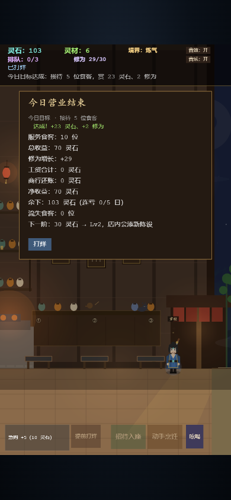

# 灵膳楼

修仙 × 酒楼经营。白日开门迎客赚灵石，夜里修行破境界；修到大乘可渡劫飞升，带着仙缘重开一局。

## 运行

```bash
npm install
npm run dev     # 本地开发
npm test        # 纯逻辑单元测试
npm run build   # 生产构建
```

画面按 720×1280 设计，Phaser FIT 缩放到手机竖屏或桌面窗口。

## 一局怎么玩

1. **打烊阶段**：采购灵材、雇伙计、营造（雅座 / 灶台 / 门面）、选今日菜单（菜单页直接显示库存并可备货），然后点「开始营业」。
2. **营业中**：食客在门外排队，点「招待入座」；入座后雅座上方显示订单，点出菜行对应菜品（对口味 +50%，没上这道菜只付半价）。也可以点「动手烹饪」按菜单顺序轮转。镜头可左右拖动查看队尾。
3. **结账与打烊**：一局没有倒计时——当天名单上的客人全部走完（吃完或流失）就自动收摊。用膳结束自动结账；打烊时还在用膳的照常结算，已下锅没出餐的退回灵材。每天从「本日收入 / 满足口味」两个目标里挑一个，达成给全赏，做到 60% 也给半赏；全赏 = 基础灵石 + 当日收入 15%，结算另扣店面日租。结算页先给当日净收益与目标结果，再列成本明细。
4. **修行**：**只有亲自下厨得修为**（2 点，命中口味再 +1）；伙计出菜只得灵石。可在伙计面板暂停灶上/跑堂/采买自动，自己下场。修为推动炼气 → 筑基 → 金丹 → 元婴 → 化神 → 炼虚 → 合体 → 大乘。
5. **飞升**：修到大乘后可在「修行·境界」里渡劫飞升，重置本局并永久累加仙缘（售价 +10%/重；每 3 重新周目开局酒楼 +1 级）。

## 操作

- 打烊：左侧进入伙计 / 营造 / 修行 / 账簿 / 玩法 / 存档，底部绿色「开始营业」。
- 营业：点「招待入座」；食客入座后点出菜行指定菜品，或「动手烹饪」按菜单轮转。点人物、或点雅座的桌卡/桌面，都会拉出一张金框人物卡（4.2× 肖像、姓名、情境台词）。在场景空白处左右拖动镜头查看门外队尾。当天的客人总数由声望等级决定，可随时提前打烊（剩余客人算流失）。

## 主要系统

- 食客类型（含稀客仙门长老 / 魔道散人）、口味与客单价；对口味 +50%，菜单没上这道菜只付半价（菜单页会标出每道菜被谁偏爱）；像素版各类食客带自己的武器/道具与进店方式（御剑、乘云、化烟、裂空、挑担、急行），修士身周有灵光；新档第一位客人固定是御剑而来的剑修「白无锋」
- 每日招牌：解锁两道菜后每天轮换一道，售价上浮约 25%（界面显示实际百分比），菜单与出菜行用 ◆ 标出，逼你在走量和高价之间换菜
- 每位食客都有姓名；吃到心头好（或本来不挑、安稳吃完）的客人会变成常客，最多记住 6 位，隔日带名再来并点同一道菜；开张前的菜单会预告今天会来的常客与想吃的菜，第一位客人就是预约常客；特写会报「第 N 次来」
- 显示进行中的上座/烹饪进度条（橙=玩家，蓝=伙计）与剩余秒数
- 四类伙计岗位、熟练度升级、日薪、产线瓶颈提示；跑堂/灶上/采买可分别暂停自动
- 三条营造升级线：雅座扩建、灶台专精、门面招幡；升级会改变店内陈设（红绸/金线/盆栽/小灯/红毯）与门面旗幡；打烊期升级会按新等级重算目标与奖励并保留已选类型，新菜自动加入今日菜单；成本随等级上涨（雅座 30 起，灶台 34，门幡 26）。**门面招幡与迎客伙计的招客效果本期已拆除、待重做**，二者目前仍可购买/雇佣但不产生效果
- 每日目标二选一（本日收入 / 满足口味，默认保留上次类型）；连达 3 天触发「三日之约」额外奖励；每 7 天一次灯会（多来 3 位客人、目标赏 ×1.5）；结算扣日租（Lv1 12 灵石，每级 +4）
- **声望**：九级称号（无名小馆 → 仙凡共仰），决定每天来几位客人（5 → 16）与稀客比例（每级 +1 倍权重）；服务客人 +10（稀客 +25），客人流失 −20，一批流失最多掉一级；状态栏常驻称号与进度，次日生效
- **天时**：按本机公历日期每天轮换一条当日环境（晴/灵雾/落英/集市/夜雨/月满），影响客人数、稀客、口味赏、灵材采购价或下厨修为；同一天内所有回合共用，跨天自动换，菜单、状态栏与开场题头都会显示
- **开市利是**：本机每天第一次开店自动发放灵石/修为/灵材，连续天数越多赏越高（封顶 7 天），断一天重来；领取日期写进存档，飞升与破产不清零
- **连击**：亲手连续端中食客想吃的菜，每连 +5% 售价、最多 +25%，上错一次清零；伙计出菜不参与，逼你在自动线之外亲自读订单
- 灵材见底时禁止继续领客入座并红字提示补货；结算单独列出因缺料流失的客人数
- 菜单走量 vs 高客单：高价菜每秒收益更低，靠口味/稀客加成
- 八重境界、飞升与仙缘；只有亲自下厨得修为
- 随机事件（整体期望为正，按当天客人数缩放，每局 1–4 次）与见闻录
- **正在转向水墨像素风**（见 `docs/adr/0008-ink-pixel-art-direction.md`）：场景/图标用像素网格与限定色，中文题字保留楷体。标题页、打烊页、菜单框、营业内景与人物已换成像素画面：像素底图（月/雾/山/屋檐/窗/挂画/后柜/灶台/门/地面/灯笼/猫）、48×64 像素人物，队列与桌距同步放宽；中文题字与 HUD 保留平滑字体；结算弹窗为墨黑底/朱砂边/金色角钉。特写卡作为近景立绘暂留平滑矢量，账簿/伙计/营造等次级页面逐屏替换中。
- 程序合成画面：新档进店的 4 秒旁白与灯笼开场（可跳过）、店内灯笼与每桌小烛明暗呼吸、窗光斜落地面、营业中升起的金色尘埃、三层远山、窗棂、山水挂画与酒坛；每日开场题头与天时粒子（晴/灵雾/落英/夜雨）
- 小人会呼吸、眨眼、带身份道具（剑/葫芦/长须/草帽/犄角/托盘/酒旗），袍面有受光/暗面、滚边与袖口，排队时微愁、用膳时沉到桌后（桌沿挡住腰腿、碗/手/筷子在桌沿）张嘴笑并带腮红、稀客冷脸；入座和用膳有碗筷热气，下厨有灵气微光，等菜时会说话；**点人物或桌卡会拉出金框人物卡**，卡上有 4.2× 肖像、姓名和情境台词
- 每日开张有「第 X 日 + 今日天时」题头与天气粒子
- 程序合成的操作/事件音效，可静音（无背景音乐）
- 跨周目账簿：累计数据、本机单日最高记录、单日收入前 5 榜、10 项成就
- 本地自动存档（营业中不落盘，避免跳过工资/还账）；「存档」页可导出/导入 `LS2.` 导出码，换设备不丢进度。**v2 起不兼容 v1 旧档**

## 画面





自动化试玩、平衡数字与已知边界见 [docs/playtest.md](docs/playtest.md)。领域词汇与技术决策见 [GLOSSARY.md](GLOSSARY.md) 与 [docs/adr/](docs/adr/)。
